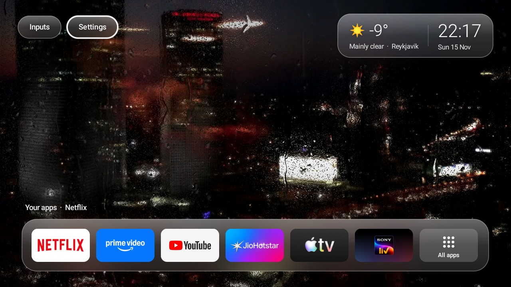
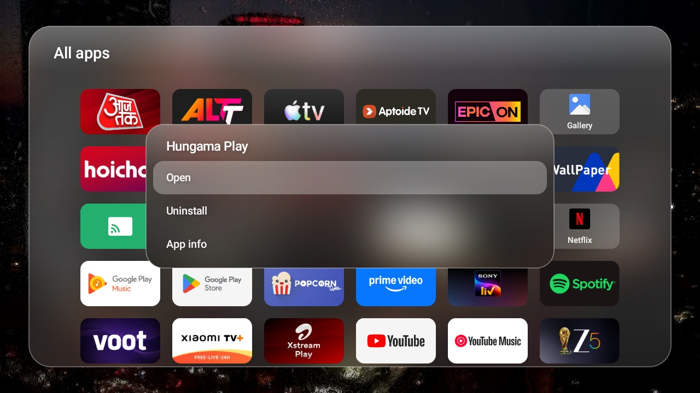

# Clean TV · Glass Launcher

A vibe-coded project to debloat an Android TV and give it a calm, "liquid glass" home screen: a **live video
wallpaper that follows the time of day and the weather**, frosted-glass panels that blur whatever moves
behind them, your streaming apps one press away, and what's trending on the apps you actually have.



## What you get

- **Live wallpaper.** Twelve looping clips (morning, day, evening, night × clear, cloudy, rain). The launcher
  picks one from the real sunrise and sunset and the current weather where you live, and changes it as the day
  goes on. You can pin any clip in Settings, and go back to automatic with one press.
- **Glass everywhere.** Every panel samples a blurred copy of the wallpaper under it, also while it moves.
- **Clock and weather** at the top right (Open-Meteo, ECMWF forecast, no account needed). Pick any city in
  Settings with a search.
- **Tray.** Your six main apps and All apps. Press Down for seven more, picked by how much you use them.
- **Trending.** Popular films and series on the streaming apps installed on your TV, from TMDB, optionally in
  one language, as a Films row and a Series row. Select a title for where to watch it and its trailer.
- **Continue watching.** Netflix's own "continue watching" card (the exact episode), what was last playing,
  and the video apps you used recently.
- **Volume light.** Change the volume and a streak of light rises or falls along the right edge of the screen,
  over any app, with a lens-flare head, a light trail and the level beside it; mute dims it to an ember. It
  also works when the sound goes to a soundbar over HDMI ARC, where Android TV hides its own volume bar.
  Switch it off in Settings.
- **Hold OK on any app** for Open, Uninstall and App info.
- **Inputs** (HDMI and Live TV) and **Settings** pills at the top left. The interface is in English.



## Set up your TV with one prompt

You need a computer on the same network as the TV and a coding agent that can run commands (Claude Code,
Codex, Gemini CLI and the like). Then:

1. On the TV, switch on **Developer options → USB debugging / Network debugging** and note its IP address.
2. Clone this repo, open your agent in it, and paste:

   > Read PROMPT.md in this repo and follow it to set up my Android TV. Ask me what you need.

The agent asks a few questions (TV address, city, country, tray apps, whether to debloat), then debloats the TV
safely with [cleanyourtv](https://github.com/Gathin23/cleanyourtv), builds this launcher, installs it, makes
it Home, loads the wallpapers and closes ADB again at the end. [PROMPT.md](PROMPT.md) is the whole procedure, if
you'd rather read it first or do it by hand.

**Trending needs a free TMDB key.** Make a TMDB account, open Settings → API, and copy the **API Read Access
Token**. The agent saves it to `tmdb_key.txt` on your computer; it never goes into git. Without a key
everything else works and Trending says a key is missing.

## Wallpapers

The twelve ready-made clips, already looped and sized for the TV, are a download on the
[Releases page](https://github.com/diganta-svnit/Clean-TV---Glass-Launcher/releases), in two packs: **720p** (49 MB)
for TVs whose home screen runs at 1280×720, and **1080p** (109 MB) for Full HD and 4K TVs. The agent checks your TV and
fetches the right one; budget TVs (about 1.5 GB of RAM or less, or under 1 GB of free storage) keep the 720p pack. (4K TVs draw their home screen at 1080p, so 1080p is the sharpest a launcher can show.)

To use your own clips: [wallpapers/README.md](wallpapers/README.md) lists the twelve slots and what makes a
good clip, and `wallpapers/convert.sh` turns any clips into seamless 720p loops (or 1080p with `RES=1080`) with their poster frames.

## Requirements

- Android TV 8.0 or newer (the launcher's `minSdk` is 26). Built for and tested on a 1 GB Xiaomi Mi TV with
  Android TV 9; the video pauses whenever you open the tray, a menu or an app, to stay light.
- To build: JDK 17 and the Android SDK (platform 34, build-tools 34). The prompt installs them if they're missing.

## Build by hand

```bash
cp glass.properties.example glass.properties    # then edit it
echo "your TMDB read token" > tmdb_key.txt       # optional
cd launcher && ./gradlew assembleRelease
```

The APK is `launcher/app/build/outputs/apk/release/app-release.apk`. Install it with `adb install -r`, make it
Home, and grant the extras listed in [PROMPT.md](PROMPT.md#5-install-and-make-it-home).

## Privacy

The launcher has no analytics and no account. It talks to:
- **Open-Meteo** for the weather and city search: it sends the city's coordinates (the city centre, not your
  location).
- **TMDB** for Trending and posters, with your own key.
- Apps' own poster images that they publish to the TV's home-screen rows.

Continue watching reads Android's media sessions and the apps' home-screen rows **on the TV only**; nothing
leaves the TV. The permissions behind it (usage access, TV listings and the developer permission DUMP) are
granted over ADB and can be revoked at any time; each one is optional.

## Undo

Make the old launcher Home again and remove this one:

```bash
adb shell cmd package set-home-activity com.google.android.tvlauncher/.MainActivity   # your TV's stock launcher
adb uninstall tv.glasshome.launcher
```

The debloat steps are undone with cleanyourtv's `tools/restore.sh` (see its README).

## Credits

- [cleanyourtv](https://github.com/Gathin23/cleanyourtv) (MIT): the debloat procedure, safety rules and the ADB
  tools this setup uses.
- Weather and place search: [Open-Meteo](https://open-meteo.com/) (CC BY 4.0).
- Films and series: [TMDB](https://www.themoviedb.org/). This product uses the TMDB API but is not endorsed or
  certified by TMDB.
- Wallpaper clips: [Pexels](https://www.pexels.com/) and [Pixabay](https://pixabay.com/), under their licences.

Code: MIT, see [LICENSE](LICENSE).
